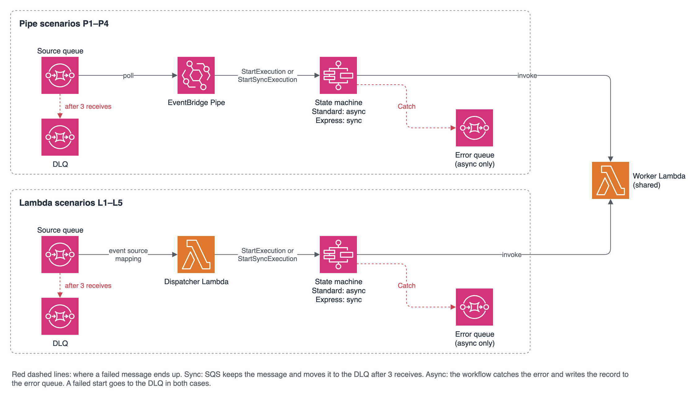

# SQS to Step Functions with EventBridge Pipes and Lambda

Companion code for a blog post on [andi-john-dev.de](https://andi-john-dev.de/blog).
It shows how SQS messages can start a Step Functions workflow, either through
EventBridge Pipes or through a dispatcher Lambda, and what that means for error
handling and throughput.



The stack has nine scenarios side by side: four with a Pipe (P1–P4) and five
with a dispatcher Lambda (L1–L5). Red dashed lines in the diagram show where a
failed message ends up.

## Scenarios

Each scenario is one entry in `cdk/lib/scenarios.ts`: Pipe or dispatcher
Lambda, Standard or Express workflow, sync or async start, batch size, batching
window and visibility timeout. Each scenario gets its own source queue, DLQ and
state machine. All scenarios share one worker Lambda.

The visibility timeout must cover the time a message is in flight:

| Scenarios | Visibility timeout | Why |
| --- | --- | --- |
| P1, P2 (async Pipe) | 1 minute | The pipe only starts the execution. |
| P3, P4 (sync Pipe) | 6 minutes | An Express execution runs up to 5 minutes. With a batching window (P4), the pipe sets its own: 7 minutes + window + 30 seconds. |
| L1–L5 (dispatcher Lambda) | 6 minutes 5 seconds | AWS recommends 6 × the function timeout (1 minute) plus the batching window (5 seconds). |

## Layout

| Path | Content |
| --- | --- |
| `cdk/` | CDK app in TypeScript, one stack with all scenarios |
| `src/` | Python code for the Lambda functions |
| `tests/` | Unit tests for the Python code |
| `scripts/` | Scripts to send test messages and inspect queues |
| `docs/` | Overview diagram (`architecture.drawio`, exported as PNG) |

## Requirements

- Node.js 20 or newer
- Python 3.14
- Docker (the CDK bundles the Python Lambdas in a container)
- An AWS account with a bootstrapped CDK environment

## Setup

```bash
# Python
python3.14 -m venv .venv
source .venv/bin/activate
pip install -r requirements-dev.txt

# CDK
cd cdk
npm ci
```

## Commands

```bash
pytest                    # Python unit tests (repo root)
# with the stack deployed:
python scripts/send_messages.py --scenario P4 ok fail transient slow:30   # one message per case
python scripts/inspect_queues.py --scenario P4 --minutes 30              # queues, pipe, executions
python scripts/measure_executions.py --scenario P3 --since 18:06:30          # Express runs per second
python scripts/smoke_workflows.py   # start the 4 workflow types directly

cd cdk
npm test                  # CDK tests
npm run build             # type-check the CDK app
npx cdk synth             # synthesize the CloudFormation template
npx cdk deploy            # deploy the stack
npx cdk deploy -c scenarios=P3,L4   # deploy only some scenarios
npx cdk destroy           # remove the stack
```
